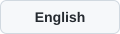

# 三维曲面实验室

[](README.md) [](README.en.md)

**改方程，看曲面，理解它们之间的关系。** 通过观察 Q 和系数的变化，探索不同曲面之间的演变关系，减少对方程和形状的死记硬背。将切面的方程、二维截线和三维曲面放在一起，帮助学生建立从二维到三维的理解。

[打开中文版](https://zavierchen.github.io/surface-lab/zh.html) · [打开英文演示版](https://zavierchen.github.io/surface-lab/) · [下载英文离线包](https://github.com/ZavierChen/surface-lab/releases/latest/download/Surface-Lab-English-Demo.zip) · [版本与附件](https://github.com/ZavierChen/surface-lab/releases)

## 快速开始

直接打开上方在线链接即可使用，无需下载。网站由 GitHub Pages 托管，不依赖作者电脑开机，也无需自行租服务器；计算在访问者的浏览器中进行。首次打开在线版需要联网。

下载英文演示包并解压，打开 **`surface-lab-en.html`** 即可使用。需要支持 WebGL 的现代浏览器；使用时无需安装 Node.js、启动服务器或联网。

Windows 用户也可以打开包内的 **`Surface Lab Demo.exe`**，需要 Windows x64 和 Microsoft Edge WebView2 Runtime。包内的 `START-HERE.txt` 提供快速操作说明和课堂演示步骤。

> 当前下载包为英文版。源代码同时提供中文和英文构建，两者共用同一套数学与鼠标操作逻辑。

## 可以探索什么

| 功能 | 说明 |
| --- | --- |
| 曲面预设 | 球面、椭球面、单叶与双叶双曲面、椭圆锥面、椭圆抛物面、马鞍面、椭圆柱面 |
| 调整方程 | 在顶部等式直接输入 x、y、z 的系数与 Q；用六个箭头调整 0～4 次，观察形状和分类变化 |
| 平面截线 | 选择 x = k、y = k 或 z = k，同时观察三维切平面和二维交线 |
| 观察方式 | 实体、半透明、轮廓、网格与参考锥面；支持 X、Y、Z 正视图 |
| 保持视角 | 调整滑条、画质或窗口大小时，保留当前观察方向、平移和缩放 |

顶部输入与左侧控件双向同步。0 次项按常数 1 计算；修改显式方程左侧变量的系数或次数时，会切换为隐式方程。

## 性能与画质

滑动时连续显示简化预览，只绘制最新参数；停稳约 0.22 秒后逐级恢复细节。预览按绘制耗时自动调整采样密度，目标最多每秒 20 次更新，实际速度取决于电脑。手动画质控制最终细节；轮廓效果在停稳后恢复。

实体和半透明的解析曲面直接使用带索引的三角网格，复用连接关系；Q 变化时参考锥面保持缓存。高次曲面的 Q 作为等值面阈值，复用采样值。突出轮廓模式保留原等高线绘法，可能较慢。

无变化时不重绘；切换三维外观不会重画二维截线，隐藏切平面后调整截线也不会重画三维曲面。

## 鼠标与视角

| 操作 | 说明 |
| --- | --- |
| 左键拖动 | 抓取图形做三维旋转，靠近你的一面跟随鼠标移动 |
| 右键拖动 | 像转方向盘一样，绕坐标原点顺时针或逆时针转动画面 |
| 左右键一起拖动 | 平移整个图形，无需 Shift |
| 滚轮 | 放大或缩小 |
| X / Y / Z 正视 | 从对应坐标轴正方向看向原点，采用正交投影 |
| 恢复视角 | 返回第一卦限透视图，不改变方程 |

## 一个课堂实验

选择 **“重点实验：Q 变化与双曲面”**，观察方程：

$$x^2 + z^2 - y^2 = Q$$

| Q | 曲面 |
| --- | --- |
| Q > 0 | 单叶双曲面 |
| Q = 0 | 椭圆锥面 |
| Q < 0 | 双叶双曲面 |

用 ±0.01 按钮观察接近零时的变化，再打开参考锥面、移动切平面，比较腰部、顶点间隙和截线。更完整的讲解步骤见[英文说明中的课堂演示](README.en.md#a-three-minute-classroom-demonstration)。

## 数学模型与边界

隐式模式使用 $A x^{p_x} + B y^{p_y} + C z^{p_z} = Q$；显式模式将 x、y 或 z 单独放在左边。分类综合考虑非零系数、指数、Q 和退化情形。标准二次曲面使用解析参数化，更高次曲面使用数值采样；截线通过将一个坐标固定为 k 得到。

图形仅显示指定范围内的部分。有限采样可能遗漏细小结构，可缩小显示范围或提高画质来检查。半透明曲面可能出现 WebGL 前后遮挡顺序误差。

## 开发与验证

<details>
<summary><strong>从源码构建</strong></summary>

### 网页版本

构建需要 Node.js；仓库已包含 Plotly gl3d。生成的单文件 HTML 可离线运行。

```powershell
node scripts/prepare.js
node build/build-zh.js
node build/build.js
```

| 输出 | 说明 |
| --- | --- |
| `outputs/surface-lab.html` | 中文版 |
| `outputs/三维曲面实验室.html` | 中文版的同内容副本 |
| `outputs/surface-lab-en.html` | 英文演示版 |

### 在线版

运行 `node scripts/build-site.js` 将已构建的中英文 HTML 写入 `outputs/site/`，附带语言切换链接。主分支更新后，GitHub Actions 自动构建并发布到 GitHub Pages。离线 HTML 和 EXE 保持独立。

### Windows 桌面版

需要 Windows x64、.NET Framework 4.x 编译器和 WebView2 Runtime。将 Microsoft.Web.WebView2 **1.0.3485.44** NuGet 包解压到 `build/webview2-sdk/`，确保包含 `lib/`、`runtimes/`、`LICENSE.txt` 和 `NOTICE.txt`。完成上述网页构建后运行：

```powershell
powershell -NoProfile -ExecutionPolicy Bypass -File build/compile-desktop.ps1 -Language zh
powershell -NoProfile -ExecutionPolicy Bypass -File build/compile-desktop.ps1 -Language en
```

分别生成 `outputs/surface-lab.exe` 和 `outputs/surface-lab-en.exe`。网页与 SDK 组件内嵌于 EXE；运行电脑仍需安装 WebView2 Runtime。两个语言版本使用独立的用户数据目录。

</details>

<details>
<summary><strong>项目结构与测试</strong></summary>

| 路径 | 内容 |
| --- | --- |
| `src/math/` | 方程模型、分类、截线与网格 |
| `src/ui/` | 控件、相机、渲染与事件 |
| `src/i18n/`, `src/templates/` | 中文映射与界面模板 |
| `src/desktop/` | Windows WebView2 外壳 |
| `scripts/` | 网页与桌面版构建脚本 |
| `tests/`, `vendor/` | 回归测试与第三方绘图库 |

请修改 `src/` 下的源文件后重新构建。`build/` 和 `outputs/` 为生成目录，不纳入版本控制。

```powershell
node scripts/prepare.js
node build/test-core.js
node build/test-mesh.js
node build/build-zh.js
node build/build.js
node build/test-zh.js
node build/test-controls.js
node build/test-camera-demo.js
node build/test-mouse-camera.js
node build/test-grab-roll.js
node build/test-equation-editor.js
node build/test-performance.js
```

浏览器测试需要 Playwright 和 Microsoft Edge。可用 `PLAYWRIGHT_PATH` 指定 Playwright 模块路径，用 `EDGE_PATH` 指定浏览器路径。截图保存在 `build/`。

测试覆盖数学分类、八个预设、Q 跨零变化、截线、离线运行及响应式布局。相机测试读取实际 WebGL 相机和渲染矩阵，检查抓取方向、绕原点的画面旋转、双键平移、缩放，以及重绘和窗口调整后的视角保持。

</details>

性能对比可运行 `node tests/benchmark-interactions.js before.html after.html`，在同一浏览器、相同画质下比较多个参数更新路径。

## 许可与第三方组件

项目自身代码尚未指定许可证。第三方组件及其许可证见 [THIRD_PARTY_NOTICES.md](THIRD_PARTY_NOTICES.md)。
